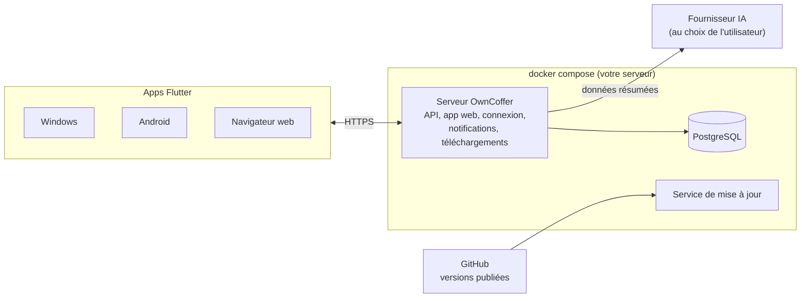

# OwnCoffer — Cahier des charges

Version du 30 octobre 2026. Ordre de réalisation : voir [ROADBOOK.md](ROADBOOK.md).

## Présentation et objectifs

OwnCoffer est une application de gestion de comptes bancaires, utilisable sur Windows, Android et navigateur web, avec des données partagées entre tous les appareils.

Objectifs :

- Gérer un ou plusieurs comptes bancaires (courant, livret, joint…) au sein de groupes d'utilisateurs.
- Importer les opérations depuis les fichiers téléchargés sur l'espace client de la banque (format Money : QIF, OFX, et CSV en secours).
- Saisir des opérations et prévoir les opérations à venir pour connaître son solde futur.
- Classer les opérations par catégorie, automatiquement autant que possible.
- Fixer des objectifs de dépenses par catégorie et être alerté en cas de dépassement.
- Obtenir des conseils sur la tenue et la gestion du compte grâce à une IA connectée.
- Héberger soi-même le serveur avec Docker, ou utiliser l'app seule sur Windows ou Android sans serveur ; applications et serveur se mettent à jour automatiquement.

Dépôt : [cmathias27/OwnCoffer](https://github.com/cmathias27/OwnCoffer). Phase actuelle : conception, aucun code écrit. Ordre de réalisation : serveur et application web d'abord, voir le [roadbook](https://claude.ai/artifact/MtzaHUmEaiqemKcGMS1H65).

## Plateformes et architecture

Un serveur Docker auto-hébergé contient la base de données et l'application web ; les applications Windows et Android se connectent à ce même serveur.



- **Flutter** : un seul code pour Windows, Android et web, interface identique partout. La version web est servie directement par le serveur.
- **Serveur OwnCoffer** (un conteneur) : l'API, l'application web, la connexion des utilisateurs, les notifications, la page de téléchargement des apps, la fonction IA et le blocage automatique des adresses IP suspectes. Écrit en Dart pour partager du code avec l'app (modèles de données, lecture des fichiers QIF) ; framework recommandé : Serverpod, si sa licence est compatible avec l'AGPL (à confirmer).
- **PostgreSQL** : dans le même fichier `docker-compose`, avec un volume persistant pour les données. La base reste dans son propre conteneur, à côté du serveur : c'est la pratique standard, et elle permet de mettre à jour le serveur sans toucher aux données.
- **Service de mise à jour** : un petit conteneur qui surveille les nouvelles versions publiées sur GitHub (détail plus bas).
- **Connexion des apps** : à la première ouverture, l'utilisateur saisit l'adresse du serveur, ou scanne un QR code affiché dans l'app web.
- **Accès depuis l'extérieur** (téléphone hors de la maison) : HTTPS obligatoire, via un reverse proxy (Caddy ou Traefik) et un certificat Let's Encrypt.
- **Hors-ligne** sur Windows et Android : un cache local permet de consulter et saisir sans réseau, puis tout se synchronise au retour de la connexion.
- **Supabase n'est plus utilisé** : connexion et permissions sont gérées par le serveur OwnCoffer, avec les permissions PostgreSQL (RLS) en seconde barrière.

## Déploiement et mises à jour

Une seule commande installe le serveur ; ensuite, serveur, app web et apps se tiennent à jour d'eux-mêmes.

### Installation du serveur

- Un fichier `docker-compose.yml` et un fichier `.env` (adresse du serveur, mots de passe, email de l'admin), puis `docker compose up -d`.
- Machine possible : NAS (Synology, QNAP), mini-PC, Raspberry Pi 4 ou 5, serveur loué (VPS).
- Au premier lancement, un assistant dans l'app web crée le compte administrateur du serveur et le premier groupe.
- Image publiée sur GitHub Container Registry (`ghcr.io/cmathias27/owncoffer`), pour processeurs Intel/AMD et ARM.
- Sauvegarde automatique de la base chaque nuit et avant chaque mise à jour, avec une durée de conservation réglable et une commande de restauration.

### Téléchargement des applications

- L'app web propose une page **Télécharger** : l'APK Android, l'installeur Windows, le numéro de version et un QR code pour installer sur téléphone.
- Les fichiers d'installation sont inclus dans l'image Docker : les apps proposées correspondent toujours à la version du serveur.
- Un bandeau dans l'app web suggère l'app adaptée à l'appareil (Android ou Windows).

### Mises à jour automatiques

| Élément | Détection d'une nouvelle version | Installation |
| --- | --- | --- |
| Serveur (conteneur) | Le service de mise à jour consulte les versions publiées sur GitHub une fois par jour | **Automatique** à l'heure choisie : sauvegarde de la base, nouvelle image, migration, redémarrage. **Manuelle** si l'admin le préfère : notification, puis bouton « Mettre à jour ». Retour à la version précédente si le démarrage échoue |
| Application web | Livrée avec le serveur | Aucune action : la page se recharge sur la nouvelle version, avec un bandeau « OwnCoffer a été mis à jour » et la liste des nouveautés |
| Android | L'app compare sa version à celle du serveur au démarrage et chaque jour | Téléchargement automatique de l'APK depuis le serveur ; Android demande une confirmation d'installation, obligatoire hors Play Store |
| Windows | Comme Android | Téléchargement en arrière-plan, installation à la prochaine ouverture de l'app |

Règles communes :

- **Notification à chaque nouvelle version** : à l'admin pour le serveur, à chaque utilisateur pour son app, avec les nouveautés.
- **Compatibilité** : le serveur accepte les apps de la version précédente ; une app trop ancienne est bloquée avec un message « mettez à jour » et le lien de téléchargement.
- **Seul le service de mise à jour a accès à Docker** : le serveur OwnCoffer ne peut pas piloter Docker lui-même, ce qui limite les risques en cas de faille.
- **Mises à jour signées** : APK signé, installeur Windows signé, image Docker vérifiée avant installation.

## Version autonome (sans serveur)

Les applications Windows et Android fonctionnent aussi seules, sans serveur ni Docker, pour une personne qui gère ses comptes sur un seul appareil.

- **Au premier lancement**, deux choix : « Utiliser seul sur cet appareil » ou « Se connecter à un serveur ».
- **Installation** : télécharger l'app depuis les versions publiées sur GitHub (F-Droid plus tard), l'ouvrir, c'est tout.
- **Données** : une base SQLite chiffrée sur l'appareil, avec le même modèle de données que le serveur.
- **Fonctions** : import, classement, objectifs, prévisions, crédits, graphiques et notifications locales, comme en mode serveur.
- **Passage au mode serveur** : un bouton « Migrer vers un serveur » envoie toutes les données ; le retour se fait par export et import.
- **Pas de version web autonome** : le stockage d'un navigateur n'est pas assez fiable pour des données bancaires.
- **Architecture** : une couche d'accès aux données commune, avec une version locale et une version serveur. L'essentiel du code est partagé, et cette couche est de toute façon nécessaire au mode hors-ligne.

|  | Mode autonome | Mode serveur |
| --- | --- | --- |
| Utilisateurs | Une personne | Groupes, rôles, invitations |
| Appareils | Un seul | Tous, synchronisés |
| Version web | Non | Oui |
| IA | Appel direct depuis l'appareil, clé dans le coffre du système | Via le serveur |
| Mises à jour | L'app vérifie les versions publiées sur GitHub | Via le serveur |
| Sauvegardes | Export chiffré automatique vers un dossier (Nextcloud, OneDrive…) | Chaque nuit sur le serveur |
| Notifications | Sur l'appareil | Appareil, Windows, Android, email |
| Feedback | Issue GitHub pré-remplie | Admin du serveur, puis GitHub |

## Utilisateurs, groupes et rôles

Toutes les données appartiennent à un groupe ; un utilisateur n'accède qu'aux groupes dont il est membre, avec un rôle par groupe.

- **Utilisateur** : une personne avec un compte de connexion (email + mot de passe, ou Google), double authentification possible.
- **Groupe** : un foyer, un couple, une association. Un utilisateur peut appartenir à plusieurs groupes, avec un rôle différent dans chacun.
- **Invitation** : un admin invite par email ; la personne rejoint le groupe en acceptant.
- **Visibilité par compte** : un compte peut être partagé avec tout le groupe ou réservé à certains membres (ex. compte perso dans un groupe familial).

| Action | Admin | User | Lecteur (proposé) |
| --- | --- | --- | --- |
| Consulter comptes et opérations visibles | Oui | Oui | Oui |
| Saisir, modifier, catégoriser des opérations | Oui | Oui | Non |
| Importer un fichier QIF / OFX / CSV | Oui | Oui | Non |
| Créer ou clôturer un compte bancaire | Oui | Non | Non |
| Gérer catégories et règles du groupe | Oui | Non | Non |
| Inviter, retirer un membre, changer un rôle | Oui | Non | Non |
| Utiliser l'assistant IA | Oui | Oui | Oui |

Un groupe garde toujours au moins un admin ; le dernier admin ne peut pas partir sans en désigner un autre.

## Fonctionnalités

### Comptes

- Plusieurs comptes par groupe : courant, livret, épargne, carte à débit différé, espèces.
- Pour chaque compte : nom, banque, devise (EUR par défaut), solde initial, couleur.
- Trois soldes affichés : **réel** (opérations pointées), **actuel** (toutes les opérations passées) et **prévisionnel** (avec les opérations prévues).
- Virements entre comptes reconnus comme tels, pour ne pas les compter en dépense ni en revenu.

### Import de fichiers bancaires

- Formats : **QIF** (le « format Money » des banques françaises), **OFX**, **CSV** avec choix des colonnes.
- Lecture du fichier sur l'appareil, puis aperçu avant validation.
- **Détection des doublons** : chaque opération reçoit une empreinte (date, montant, libellé, compte) ; réimporter un fichier qui se chevauche n'ajoute rien en double.
- Gestion des formats français : dates JJ/MM/AAAA, virgule décimale, accents (Windows-1252 ou UTF-8).
- Historique des imports, avec possibilité d'annuler un import entier.

### Saisie et prévisions

- Saisie manuelle : date, montant, libellé, tiers, catégorie, note, pièce jointe (photo de ticket ou facture).
- **Opérations prévues** ponctuelles ou récurrentes (chaque mois, chaque trimestre, le N du mois…) : loyer, salaire, abonnements, impôts.
- **Rapprochement** : quand l'import apporte l'opération réelle, elle est associée à l'opération prévue correspondante (montant et date proches) ; l'utilisateur confirme.
- Pointage des opérations, comme sur un relevé.
- **Simulateur d'achat** (version 1.0) : « si j'achète cet équipement à 600 € ce mois-ci, quel sera mon solde au 25 du mois prochain ? ». On saisit un montant, une date et un compte ; l'app affiche le solde à la date choisie, le point bas et sa date, et prévient en cas de découvert ou d'objectif dépassé. Variantes : payer en 3 ou 4 fois, ou attendre le mois suivant, comparées côte à côte. Le scénario retenu s'enregistre en un clic comme opération prévue.

### Classement

Le classement repose d'abord sur des règles, dont une base communautaire partagée et anonymisée ; l'IA n'intervient qu'en appoint, sur ce qui reste.

1. **Ordre de classement**, du plus fiable au moins fiable : règles du groupe, puis règles communautaires, puis historique (un libellé déjà classé), puis IA en option ; sinon l'opération reste « à classer ». Chaque opération indique d'où vient sa catégorie.
2. **Règles communautaires** : une base publique de correspondances « commerçant → catégorie » (« CARREFOUR » → Alimentation, « SNCF » → Transport), tenue dans un dépôt GitHub public, livrée avec les mises à jour, par pays et par langue (France d'abord).
3. **Catalogue de catégories standard** avec des identifiants stables : chaque groupe y associe ses propres catégories, donc les règles communautaires marchent même si l'on renomme ou découpe ses catégories.
4. **Anonymisation** : une règle partagée ne contient que le motif du libellé nettoyé et la catégorie standard. Jamais de montant, de date, de compte ni de numéro (références, cartes, IBAN retirés automatiquement) ; les virements entre particuliers, qui contiennent des noms, sont exclus.
5. **Contribution volontaire** : quand on corrige une catégorie, l'app propose de partager la règle. Les propositions sont regroupées, affichées exactement telles qu'elles partiront, puis envoyées en un clic sous forme de proposition GitHub pré-remplie. Rien n'est envoyé automatiquement.
6. **Qualité** : relecture par les mainteneurs, tests automatiques (conflits, données personnelles), indice de confiance par règle, bouton « règle fausse » dans l'app.
7. **Règles du groupe** : créées en un clic depuis une correction, prioritaires sur les règles communautaires, vérifiables avec le testeur de règles.
8. **IA en appoint** : elle propose une catégorie seulement pour les opérations restées non classées, et suggère la règle correspondante. Elle n'est pas un argument principal de l'app.
9. **Catégories et sous-catégories** propres à chaque groupe, et tags libres en plus (ex. « vacances 2027 »).

### Suivi et analyse

- Tableau de bord : graphiques et chiffres clés (détail ci-dessous).
- **Courbe prévisionnelle** du solde à 30, 60 et 90 jours, avec alerte de découvert prévu.
- **Budgets** et objectifs par catégorie (détail ci-dessous).
- Détection des abonnements et prélèvements récurrents non déclarés.
- Recherche et filtres (période, montant, catégorie, compte, texte).
- Export CSV et PDF.

### Objectifs par catégorie et alertes

- **Un objectif par catégorie ou sous-catégorie** de dépenses : montant maximum par mois, par an, ou sur une période donnée (ex. cadeaux de Noël : 300 € en décembre).
- **Objectifs d'épargne** en plus (proposé) : « mettre 200 € par mois sur le livret ».
- **Suivi** : une jauge « dépensé / objectif » par catégorie, et une projection en fin de période qui tient compte des opérations prévues (« à ce rythme, dépassement de 45 € vers le 26 »).
- **Alertes à des seuils réglables**, par défaut 80 % et 100 % de l'objectif, plus une **alerte anticipée** quand la projection annonce un dépassement.
- Une alerte par seuil et par période, pour ne pas être submergé.
- **Report** optionnel : ce qui n'a pas été dépensé peut s'ajouter à l'objectif du mois suivant.
- **Historique** : objectifs tenus ou dépassés sur les 12 derniers mois.
- **Suggestion par l'IA** : objectifs réalistes calculés sur les 3 à 6 derniers mois.

### Notifications

- **Canaux** : centre de notifications dans l'app, notification système Windows et Android, email (serveur d'envoi configuré dans le `.env`).
- **Types** : objectif à 80 % ou dépassé, dépassement prévu, découvert prévu, opération prévue non arrivée, import terminé, invitation, nouvelle version disponible.
- **Réglages par utilisateur** : choix des types et des canaux, heures calmes (pas de notification la nuit).
- **Android, app fermée** : il faut un service d'envoi. Deux options : Firebase de Google, ou ntfy / UnifiedPush, auto-hébergeable à côté du serveur (voir questions ouvertes).

### Graphiques et tableaux de bord

Tous les chiffres des comptes sont mis en valeur par des graphiques interactifs : un clic sur une part, une barre ou un point ouvre les opérations correspondantes.

| Vue | Graphique | Ce qu'on y lit |
| --- | --- | --- |
| Accueil | Grandes valeurs + mini-courbes | Solde de chaque compte, total de tous les comptes, variation depuis le début du mois |
| Répartition des dépenses | Camembert en anneau, total au centre | Part de chaque catégorie ; les 6 plus grosses, le reste regroupé dans « Autres » ; un clic descend dans les sous-catégories |
| Revenus et dépenses | Barres côte à côte sur 12 mois | Ce qui entre et sort chaque mois, et le solde net |
| Évolution du solde | Courbe, projection en pointillés | Solde passé et prévu, ligne de découvert, date du point bas |
| Objectifs | Jauges par catégorie | Dépensé / objectif, en vert, orange puis rouge |
| Comparaison | Barres d'écart autour de zéro | Chaque catégorie face au mois précédent ou au même mois l'an dernier |
| Flux d'argent | Diagramme de flux (Sankey) | D'où vient l'argent (salaire, aides…) et où il va (catégories, épargne) |
| Calendrier | Calendrier coloré | Les jours et périodes où l'on dépense le plus |
| Tiers | Classement en barres | Les commerçants et organismes qui pèsent le plus |

- **Filtres communs** : période, compte(s), groupe ; ils s'appliquent à tous les graphiques de la page.
- **Bouton « masquer les montants »** pour consulter l'app en public sans afficher les chiffres.
- **Widget Android** sur l'écran d'accueil du téléphone : solde et objectif du mois en un coup d'œil.
- Thème clair et sombre ; couleur fixe par catégorie, la même dans tous les graphiques.
- Export d'un graphique en image, et rapport mensuel PDF avec les graphiques principaux.
- Bibliothèque envisagée : `fl_chart` (libre, fonctionne sur les trois plateformes).

### Crédits et paiements en plusieurs fois

Un espace dédié, en deux onglets, liste tout ce qui reste à rembourser : les crédits d'un côté, les paiements en plusieurs fois de l'autre.

**Onglet Crédits**

- **Saisie d'un crédit** : organisme, type (immobilier, auto, consommation, renouvelable, prêt entre particuliers), capital emprunté, taux nominal, TAEG, durée, date de première échéance, périodicité, assurance emprunteur (montant fixe, ou pourcentage du capital initial ou restant dû), frais de dossier, différé éventuel, compte de prélèvement.
- **Tableau d'amortissement** calculé automatiquement, ou importé depuis le fichier de la banque pour coller exactement au tableau officiel. Pour chaque échéance : date, mensualité, part de capital, part d'intérêts, assurance, capital restant dû.
- **Lien avec le compte** : chaque échéance devient une opération prévue, rapprochée du prélèvement réel à l'import ; un écart de montant est signalé.
- **Suivi** : capital restant dû, intérêts déjà payés et restant à payer, pourcentage remboursé, date de fin, graphique capital / intérêts dans le temps.
- **Événements** : remboursement anticipé partiel ou total (avec indemnités), renégociation ou changement de taux, modulation ou report d'échéance, révision d'un taux variable. Le tableau est recalculé à partir de la date de l'événement, et l'historique est conservé.
- **Crédit renouvelable** : plafond, montant utilisé, disponible.
- **Prêt entre particuliers** : argent prêté ou emprunté, avec ou sans intérêts.
- **Simulation** : « si je rembourse 5 000 € par anticipation » → intérêts économisés, nouvelle date de fin ou nouvelle mensualité.
- **Vue d'ensemble** : total restant dû, total des mensualités, taux d'endettement indicatif (mensualités / revenus du mois).

Mensualité d'un crédit à échéances constantes, avec C le capital, t le taux par période (taux annuel / 12) et n le nombre d'échéances :

```latex
M = C \times \frac{t}{1 - (1 + t)^{-n}}
```

Les calculs sont indicatifs : en cas d'écart, le tableau fourni par la banque fait foi.

**Onglet Paiements en plusieurs fois**

- **Saisie d'un achat fractionné** : commerçant, service utilisé (Alma, Oney, Klarna, PayPal en 4 fois, paiement en 3 ou 4 fois par carte…), montant total, nombre d'échéances, frais, dates, carte ou compte débité.
- **Échéances créées automatiquement** comme opérations prévues, puis rapprochées des prélèvements réels.
- **Détection à l'import** : un libellé du type « ALMA », « ONEY 3X » ou « KLARNA » propose de créer le plan de paiement.
- **Vue d'ensemble** : nombre de paiements fractionnés en cours, reste à payer total, prochaines échéances, date de la dernière.
- **Classement** : l'achat garde sa catégorie (Électroménager, Vêtements…) ; au choix, la dépense compte pour son montant total le jour de l'achat, ou échéance par échéance dans les objectifs.
- **Alertes** : solde insuffisant prévu avant une échéance, et trop de paiements fractionnés en même temps (seuil réglable, par défaut 3).

### Retours utilisateurs (feedback)

Un onglet « Feedback » permet d'envoyer un retour depuis l'app, sur les trois plateformes ; rien ne part vers l'extérieur sans action explicite.

- **Accès** : onglet « Feedback » dans le menu, lien dans « À propos », et bouton « Signaler un problème » dans chaque message d'erreur, qui pré-remplit le retour.
- **Types** : bug, idée, question, avis général, avec une note de satisfaction de 1 à 5 en option.
- **Contenu** : titre, description, capture d'écran en option (montants masqués par défaut), journal technique en option.
- **Informations techniques** ajoutées automatiquement et affichées avant l'envoi : version de l'app et du serveur, plateforme, langue. Jamais de données financières.
- **Destination 1, l'admin du serveur** : boîte de réception dans la console d'administration, statut (nouveau, en cours, résolu) et réponse à l'utilisateur.
- **Destination 2, le projet open source** : l'admin ou l'utilisateur peut transférer un retour en issue GitHub pré-remplie, ouverte dans le navigateur et publiée sous son propre compte GitHub.
- **Suivi** : chacun voit ses retours et leur statut, et reçoit une notification quand on lui répond.

### Autres fonctionnalités

Soixante-douze fonctionnalités complémentaires sont retenues : 17 pour la version 1.0, les autres ensuite. La colonne Version se modifie directement dans le tableau.

| Thème | Fonctionnalité | Ce qu'elle fait | Version |
| --- | --- | --- | --- |
| Saisie | Partager vers l'app | Sur Android, « Partager » un fichier QIF depuis l'app de la banque lance l'import | 1.0 |
| Saisie | Libellés nettoyés | « PRLV SEPA EDF SA REF 8837… » devient « EDF » | 1.0 |
| Saisie | Ventilation | Une opération répartie sur plusieurs catégories (courses : Alimentation et Maison) | 1.0 |
| Saisie | Import groupé | Plusieurs fichiers d'un coup, chacun rattaché à son compte grâce au numéro qu'il contient | 1.0 |
| Saisie | Import des relevés PDF | Pour les banques sans export QIF sur l'historique ancien | Après 1.0 |
| Saisie | Dossier surveillé | Un fichier déposé dans un dossier du serveur est importé automatiquement | Après 1.0 |
| Saisie | Scan de ticket | Photo d'un ticket ou d'une facture : opération pré-remplie et ventilée ligne par ligne (voir Volet IA) | Après 1.0 |
| Saisie | Saisie vocale et raccourci | « 12 € boulangerie » à la voix, ou tuile Android de saisie rapide | Après 1.0 |
| Saisie | Espèces | Un retrait au distributeur devient une enveloppe d'espèces dépensée ensuite | Après 1.0 |
| Contrôle | Anomalies | Prélèvement en double, facture très au-dessus de l'habitude | 1.0 |
| Contrôle | Testeur de règles | Avant d'enregistrer une règle, voir quelles opérations passées elle aurait classées | 1.0 |
| Contrôle | Solde de contrôle | Saisir le solde du relevé officiel et voir tout de suite un écart | 1.0 |
| Contrôle | Frais bancaires | Agios et commissions détectés et cumulés sur l'année | 1.0 |
| Contrôle | Revue de fin de mois | Assistant en 5 étapes : pointer, classer, vérifier les objectifs, noter, valider le mois | 1.0 |
| Contrôle | Hausses de prix | « Netflix est passé de 13,49 € à 15,99 € » | Après 1.0 |
| Contrôle | Chèques non encaissés | Suivi des chèques émis, rappel avant la fin de validité (un an et 8 jours) | Après 1.0 |
| Contrôle | Remboursements attendus | Mutuelle, notes de frais, argent prêté ; relance s'ils n'arrivent pas | Après 1.0 |
| Contrôle | Contrats | Date de renouvellement, rappel avant la date limite de résiliation | Après 1.0 |
| Contrôle | Garanties | Facture et date de fin de garantie rattachées à l'achat | Après 1.0 |
| Contrôle | Clôture de période | Un mois ou une année vérifiés ne peuvent plus être modifiés par erreur | Après 1.0 |
| Contrôle | Score de santé financière | Épargne de précaution, taux d'épargne, endettement, régularité ; chaque indicateur expliqué | Après 1.0 |
| À plusieurs | Dépenses partagées | Qui a payé quoi dans le groupe, qui doit combien, proposition d'équilibrage | Après 1.0 |
| À plusieurs | Commentaires | Discussion entre membres sur une opération | Après 1.0 |
| À plusieurs | Comptes enfants | Argent de poche, avec un rôle limité | Après 1.0 |
| À plusieurs | Pot commun au prorata | Ce que chacun doit verser sur le compte joint selon ses revenus | Après 1.0 |
| À plusieurs | Mode simplifié | Interface allégée pour un ado ou un parent âgé : solde, dernières opérations, alerte | Après 1.0 |
| Anticiper | Reste à vivre | Ce qu'il reste à dépenser jusqu'à la prochaine paie, au total et par jour | 1.0 |
| Anticiper | Calendrier des échéances | Prélèvements, échéances de crédit et paiements fractionnés à venir, sur un calendrier | 1.0 |
| Anticiper | Prévision des dépenses variables | Courses, carburant, sorties estimés d'après les mois précédents dans la courbe du solde | 1.0 |
| Anticiper | Projets d'épargne | Vacances, voiture : progression et somme à mettre de côté chaque mois | Après 1.0 |
| Anticiper | Dépenses annuelles lissées | Assurance, taxe foncière : provision mensuelle automatique | Après 1.0 |
| Anticiper | Simulateur « et si » | Scénarios combinés sur plusieurs mois : crédit, abonnement, résiliation, baisse de revenus (le simulateur d'achat simple est en 1.0) | Après 1.0 |
| Anticiper | Méthodes de budget | Objectifs par catégorie, enveloppes, 50/30/20 ou budget base zéro, au choix | Après 1.0 |
| Anticiper | Enveloppes virtuelles | Un compte découpé en sous-comptes fictifs (vacances, imprévus) | Après 1.0 |
| Anticiper | Revenus irréguliers | Revenus lissés et « salaire » mensuel à se verser, pour indépendants et intérim | Après 1.0 |
| Vie réelle | Patrimoine net | Comptes, épargne et biens (logement, voiture) moins les crédits, suivi dans le temps | Après 1.0 |
| Vie réelle | Livrets réglementés | Intérêts estimés par quinzaine, alerte à l'approche du plafond | Après 1.0 |
| Vie réelle | Coût d'un véhicule | Carburant, assurance, entretien et crédit regroupés, coût au kilomètre | Après 1.0 |
| Vie réelle | Coût par personne ou animal | Ce que coûtent un enfant ou le chien sur l'année | Après 1.0 |
| Vie réelle | Événements | Mariage, déménagement, travaux : coût total à la fin | Après 1.0 |
| Vie réelle | Mode voyage | Budget de séjour, dépenses en devise locale, conversion automatique | Après 1.0 |
| Vie réelle | Titres-restaurant | Cartes repas gérées comme un compte à part | Après 1.0 |
| Vie réelle | Dépenses pro | Marquer des dépenses professionnelles, exporter une note de frais | Après 1.0 |
| Vie réelle | Bilan annuel | Récapitulatif de l'année et opérations utiles à la déclaration d'impôts | Après 1.0 |

Documents, rapports, confort, IA et technique :

| Thème | Fonctionnalité | Ce qu'elle fait | Version |
| --- | --- | --- | --- |
| Documents | Archives | Relevés PDF, factures, avis d'imposition classés par mois, recherchables, liés aux opérations | Après 1.0 |
| Documents | Coffre chiffré | RIB, contrats, pièces d'identité protégés par un mot de passe inconnu de l'admin | Après 1.0 |
| Documents | Calendrier fiscal | Taxe foncière, acomptes, date limite de déclaration ajoutés aux échéances | Après 1.0 |
| Documents | Rappels libres | « Payer la cantine », « résilier l'essai gratuit le 12 » | Après 1.0 |
| Rapports | Générateur de rapports | Graphiques, période et comptes au choix, export PDF | Après 1.0 |
| Rapports | Lien de partage | Un rapport en lecture seule, avec date d'expiration | Après 1.0 |
| Rapports | Vues enregistrées | Recherche ou filtre sauvegardé et épinglé au menu | Après 1.0 |
| Sérénité | Dossier pour les proches | Comptes, crédits, contrats et assurances accessibles à une personne de confiance en cas d'accident ou de décès, après un délai de sécurité | Après 1.0 |
| Sérénité | Accès invité temporaire | Pour un comptable ou un conseiller, avec date d'expiration | Après 1.0 |
| Confort | Tableau de bord personnalisable | Blocs à déplacer et à masquer | Après 1.0 |
| Confort | Clavier sur Windows et web | Raccourcis et saisie rapide comme dans un tableur | Après 1.0 |
| Confort | Résumé par email | Chaque semaine ou chaque mois, envoyé automatiquement | Après 1.0 |
| Confort | Accessibilité | Grands caractères, lecteur d'écran, couleurs lisibles par les daltoniens | Après 1.0 |
| Confort | Modèles prêts à l'emploi | Jeux de catégories pour une famille, un étudiant, un couple | Après 1.0 |
| Confort | Règles partagées | Base communautaire de règles de classement, anonymisée (détail dans Classement) | 1.0 |
| Confort | Icône de la barre des tâches Windows | Solde et alertes visibles sans ouvrir l'app | Après 1.0 |
| IA | Libellé inconnu | « C'est quoi ce prélèvement ? » : l'IA explique | Après 1.0 |
| IA | Courriers prêts à envoyer | Résiliation, réclamation de frais bancaires, demande de geste commercial | Après 1.0 |
| Technique | Feedback | Envoyer un retour depuis l'app à l'admin du serveur, transférable en issue GitHub | 1.0 |
| Technique | Mode démo | Données fictives pour essayer l'app et faire les captures d'écran | 1.0 |
| Technique | Assistant de premier lancement | Créer ses comptes, importer son historique, choisir ses catégories | 1.0 |
| Technique | Corbeille | Opération ou import supprimé récupérable pendant 30 jours | 1.0 |
| Technique | Migration | Import depuis Money, Grisbi, Firefly III… | Après 1.0 |
| Technique | Home Assistant | Solde et alertes affichés dans la domotique | Après 1.0 |
| Technique | Assistant vocal Home Assistant | « Quel est mon reste à vivre ? » demandé à la maison | Après 1.0 |
| Technique | API et webhooks | Brancher d'autres outils sur OwnCoffer | Après 1.0 |
| Technique | Sauvegarde externe chiffrée | Copie des sauvegardes vers Nextcloud ou S3 | Après 1.0 |
| Technique | Importeurs communautaires | Formats de banques particuliers ajoutés en petits modules, sans toucher au cœur | Après 1.0 |

## Volet IA

L'IA sert d'abord à lire des documents et à en tirer des données prêtes à l'emploi ; l'assistant de conseils passe au second plan. Elle reste optionnelle : chaque utilisateur connecte le fournisseur de son choix avec sa propre clé, et l'application est complète sans elle.

| Priorité | Document ou usage | Ce que l'IA produit | Contrôle avant enregistrement |
| --- | --- | --- | --- |
| 1 | Photo d'un ticket de caisse | L'opération (montant, date, commerçant) et sa ventilation ligne par ligne dans vos catégories (alimentation, maison, hygiène…), rapprochée du paiement par carte | La somme des lignes doit égaler le total |
| 1 | Offre ou contrat de prêt (PDF ou photo) | Le crédit complet (capital, taux, TAEG, durée, assurance, frais) et son tableau d'amortissement, les échéances devenant des opérations prévues | Le tableau est recalculé avec la formule de la mensualité ; tout écart est signalé |
| 1 | Confirmation d'un paiement en plusieurs fois | Le plan de paiement et ses échéances prévues | Total des échéances = montant + frais |
| 2 | Facture | L'opération, la garantie (date de fin) ou le contrat (renouvellement, préavis), avec le document archivé | Montant comparé à l'opération bancaire |
| 2 | Avis d'imposition | Les échéances du calendrier fiscal | Dates et montants affichés pour validation |
| 3 | Opérations non classées | Une catégorie proposée et la règle correspondante, en appoint des règles | Validation par l'utilisateur |
| 4 | Bilans, questions, conseils | Bilan du mois en langage clair, réponses aux questions sur ses dépenses | Réponses fondées sur des requêtes aux données, sources affichées |

Pour les documents, l'IA ne fait que proposer : l'utilisateur voit et corrige chaque champ extrait avant l'enregistrement. Un contrat de prêt contient des données personnelles (nom, adresse) : l'app prévient avant l'envoi au fournisseur d'IA et recommande un modèle local capable de lire les images. Sans IA, la saisie reste manuelle, avec une lecture simple du montant et de la date par reconnaissance de texte sur l'appareil.

Principes :

- **Fournisseur au choix de chaque utilisateur**, dans ses réglages : Claude (Anthropic), OpenAI, Mistral, Google Gemini, tout service compatible avec l'API OpenAI, ou un modèle local (Ollama, LM Studio) sur son réseau.
- **Connexion simple** : choix du fournisseur et du modèle, collage de la clé, bouton « Tester » ; plusieurs connexions possibles, une par défaut.
- **Coût à la charge de chacun**, sur son propre compte chez le fournisseur ; plafond mensuel réglable et compteur d'utilisation dans l'app.
- **Clés protégées** : chiffrées dans la base, jamais renvoyées vers l'app, jamais écrites dans les journaux.
- **Appels par le serveur** : il relaie la demande avec la clé de l'utilisateur, via un adaptateur par fournisseur. Les questions libres utilisent l'appel de fonctions ; un modèle qui ne le gère pas n'a accès qu'aux bilans et à la catégorisation.
- **Contrôle du groupe** : les données d'un groupe concernent plusieurs personnes, donc un admin peut interdire l'IA pour le groupe, ou n'y autoriser que les modèles locaux.
- **Minimisation** : pas de numéro de compte, d'IBAN ni de nom de membre transmis ; les libellés sont nettoyés (références, numéros de carte).
- **Transparence** : chaque conseil indique sur quelles données il s'appuie ; l'IA propose, l'utilisateur valide (aucune modification automatique).
- L'IA donne des conseils de gestion courante, pas de conseil en investissement.

## Modèle de données

Première version du schéma PostgreSQL, hébergé dans le conteneur de base de données ; chaque table métier porte un `group_id`, ce qui permet de filtrer les accès directement dans la base.

| Table | Rôle | Champs principaux |
| --- | --- | --- |
| `users` | Utilisateurs | id, nom affiché, email, mot de passe chiffré (haché), 2FA, langue, admin du serveur |
| `sessions` | Connexions actives | user\_id, appareil, jeton, expiration |
| `groups` | Groupes (foyer, association…) | id, nom, IA activée, créé par |
| `group_members` | Appartenance et rôle | group\_id, user\_id, rôle (admin, user, lecteur) |
| `invitations` | Invitations en attente | group\_id, email, rôle, jeton, expiration |
| `accounts` | Comptes bancaires | group\_id, nom, type, banque, devise, solde initial, visibilité |
| `account_access` | Accès restreint à un compte | account\_id, user\_id |
| `transactions` | Opérations réelles | account\_id, date, montant, libellé, tiers, category\_id, pointée, empreinte, import\_id, virement lié |
| `scheduled_transactions` | Opérations prévues | account\_id, montant, libellé, category\_id, récurrence, prochaine date, fin |
| `categories` | Catégories du groupe | group\_id, nom, parent\_id, icône, type (dépense, revenu) |
| `rules` | Règles de classement | group\_id, condition (contient, commence par, montant), catégorie cible, priorité |
| `goals` | Objectifs par catégorie | group\_id, category\_id, type (dépense, épargne), montant, période (mois, an, dates), seuils d'alerte, report |
| `goal_alerts` | Alertes déjà envoyées | goal\_id, période, seuil atteint, date |
| `notifications` | Notifications envoyées | user\_id, type, titre, message, lue, date |
| `notification_settings` | Préférences | user\_id, type, canaux, heures calmes |
| `devices` | Appareils connectés | user\_id, plateforme, version de l'app, jeton de notification |
| `imports` | Historique des imports | account\_id, format, nom du fichier, nb ajoutées, nb doublons, auteur, date |
| `attachments` | Pièces jointes | transaction\_id, chemin du fichier |
| `server_settings` | Réglages du serveur | mode de mise à jour, heure, version installée, email d'envoi |
| `audit_log` | Journal des modifications | group\_id, user\_id, action, table, ligne, avant / après, date |
| `ai_connections` | Connexions IA de chaque utilisateur | user\_id, fournisseur, modèle, adresse (modèle local), clé chiffrée, par défaut, plafond mensuel, consommation |
| `loans` | Crédits | group\_id, account\_id, type, organisme, capital, taux, TAEG, durée, périodicité, assurance, frais, date de première échéance |
| `loan_schedule` | Tableau d'amortissement | loan\_id, numéro, date, mensualité, capital, intérêts, assurance, capital restant dû, source (calculé, importé) |
| `loan_events` | Événements d'un crédit | loan\_id, type (remboursement anticipé, nouveau taux, report), date, montant, indemnités, nouveau taux |
| `installment_plans` | Paiements en plusieurs fois | group\_id, account\_id, commerçant, service, montant total, nb d'échéances, frais, catégorie, mode de comptage ; échéances = opérations prévues liées |
| `transaction_splits` | Ventilation | transaction\_id, category\_id, montant |
| `transaction_comments` | Commentaires | transaction\_id, user\_id, texte, date |
| `shared_expenses` | Dépenses partagées | transaction\_id, payé par, répartition entre membres, réglé |
| `savings_projects` | Projets d'épargne | group\_id, nom, montant cible, date cible, compte d'épargne |
| `reimbursements` | Remboursements attendus | transaction\_id, de qui, montant, date prévue, opération de remboursement reçue |
| `contracts` | Contrats et garanties | group\_id, type (contrat, garantie), nom, tiers, montant, renouvellement ou fin, préavis, pièce jointe |
| `feedback` | Retours utilisateurs | user\_id, type, titre, message, note, capture, infos techniques, statut, réponse, lien de l'issue GitHub |
| `standard_categories` | Catalogue de catégories standard | id stable, parent, noms FR et EN ; categories.standard\_category\_id y renvoie |
| `community_rules` | Règles communautaires (copie locale) | motif, catégorie standard, pays, indice de confiance, version de la base |

Les montants sont stockés en centimes (entiers) pour éviter les erreurs d'arrondi.

Les suppressions passent par la corbeille : une colonne `deleted_at` marque l'élément, effacé définitivement après 30 jours.

## Sécurité et confidentialité

Les données bancaires sont sensibles : la sécurité est traitée dès la première version, pas ajoutée après.

- **Permissions à deux niveaux** : le serveur vérifie groupe, rôle et visibilité du compte à chaque requête ; les permissions PostgreSQL (Row Level Security) le revérifient en cas de bug.
- **Authentification** : mots de passe hachés (Argon2), double authentification (TOTP) proposée et recommandée aux admins, blocage du compte et de l'adresse IP après plusieurs échecs (détail ci-dessous).
- **Chiffrement** : HTTPS obligatoire dès qu'on accède au serveur depuis l'extérieur ; cache local de l'application chiffré sur Windows et Android.
- **Base non exposée** : PostgreSQL n'est joignable que par le serveur OwnCoffer, jamais depuis Internet.
- **Verrouillage de l'app** : code ou empreinte digitale sur Android, délai d'inactivité configurable.
- **Journal d'audit** : qui a créé, modifié ou supprimé quoi, consultable par les admins.
- **Secrets** : clés API et mots de passe dans le `.env` du serveur et dans les secrets GitHub, jamais dans le code.
- **Mises à jour sûres** : seul le service de mise à jour accède à Docker ; apps et image signées.
- **Données de test** : aucun vrai relevé dans le dépôt ; fichiers d'exemple anonymisés, noms de fichiers neutres (pas de numéro de compte).
- **RGPD** : export complet de ses données et suppression du compte utilisateur ; les données restent sur le serveur de l'utilisateur.
- **Sauvegardes** : chaque nuit et avant chaque mise à jour, restauration testée par la CI.

### Blocage automatique des adresses IP

Le serveur bannit lui-même les adresses IP qui accumulent les échecs de connexion ; un fail2ban sur la machine reste possible en complément.

- **Intégré au serveur OwnCoffer** : fonctionne partout, NAS compris, sans droits particuliers sur la machine.
- **Règles par défaut**, modifiables dans le `.env` : 5 échecs en 15 minutes → IP bannie 1 heure ; chaque récidive double la durée.
- **Mêmes règles** pour les codes de double authentification, la réinitialisation de mot de passe et les liens d'invitation.
- **Limite de requêtes** par IP sur toute l'API, contre les robots.
- **Administration** : liste des IP bannies dans l'app web, déblocage manuel, liste blanche (ex. réseau de la maison), notification à l'admin en cas d'attaque.
- **Vraie adresse IP** : derrière un reverse proxy, le serveur ne fait confiance qu'au proxy déclaré pour lire l'IP du visiteur ; sinon un attaquant pourrait se faire passer pour une autre adresse.
- **fail2ban ou CrowdSec en option** : le serveur écrit un journal des échecs dans un format qu'ils savent lire, pour bloquer aussi au niveau du pare-feu. Un conteneur fail2ban est fourni dans le `docker-compose`, désactivé par défaut car il demande des droits réseau étendus sur la machine (`NET_ADMIN`).

## Compilation et tests sur GitHub

GitHub Actions compile et teste chaque modification ; rien n'est fusionné sur `main` sans que les vérifications soient au vert.

| Déclencheur | Ce qui s'exécute | Résultat |
| --- | --- | --- |
| Chaque pull request | Analyse du code (`flutter analyze`), formatage, tests unitaires (dont l'import QIF/OFX), tests du serveur et des permissions sur une base PostgreSQL de test | Coche verte ou rouge sur la PR |
| Fusion sur `main` | Les mêmes vérifications, puis compilation web, Android (APK) et Windows, et construction de l'image Docker qui les contient | Image de test `ghcr.io/cmathias27/owncoffer:edge` |
| Tag de version (`v1.2.0`) | Compilation signée des trois plateformes, image Docker signée, test d'installation et de mise à jour depuis la version précédente | Release GitHub avec les nouveautés, image `ghcr.io/cmathias27/owncoffer:1.2.0` et `latest` : les serveurs installés la détectent et se mettent à jour |

Organisation du travail :

- Une branche par fonctionnalité, une pull request pour la relire et la fusionner.
- La branche `main` est protégée : fusion seulement avec les vérifications au vert.
- Les clés (signature Android et Windows, publication de l'image Docker) sont stockées dans les secrets du dépôt.
- Les compilations Windows tournent sur une machine Windows fournie par GitHub, Android et web sur Linux.

## Diffusion et licence

Le projet est gratuit, open source sous licence AGPL-3.0, financé par les dons et auto-hébergé uniquement.

- **Gratuit** : pas de publicité, pas d'abonnement, pas de version payante, aucune fonction réservée aux donateurs.
- **Licence AGPL-3.0** : chacun peut utiliser, modifier et redistribuer le code ; quiconque fait tourner une version modifiée accessible par le réseau doit en publier le code source.
- **Auto-hébergement uniquement** : aucun serveur central, aucune donnée chez le développeur, aucune télémétrie.
- **Dons** : GitHub Sponsors, Ko-fi ou Liberapay ; un lien « Soutenir le projet » dans le README et dans la page « À propos » de l'app, sans rappel insistant.
- **Contributions** : guide de contribution, et certificat d'origine (DCO) signé à chaque commit pour garder la licence claire.
- **Dépendances** : chacune doit être compatible avec l'AGPL ; vérification automatique des licences dans la CI.
- **Nom** : le projet s'appelle OwnCoffer (de l'anglais coffer, le coffre) ; le nom reste à vérifier (marque, dépôt GitHub, nom de domaine) avant la première publication.

## Qualité et exigences professionnelles

Ces exigences s'appliquent à tout le projet, dès la première version : elles font la différence entre une app qui marche et une app professionnelle.

### Expérience utilisateur

- **Charte graphique unique** : couleurs, typographie, icônes et composants communs aux trois plateformes.
- **Rapidité** : fluide avec 100 000 opérations, démarrage en moins de 2 secondes.
- **Annuler partout** : chaque action peut être annulée immédiatement (« Opération supprimée — Annuler »).
- **Recherche universelle** (Ctrl+K) : opération, compte ou réglage en quelques lettres.
- **Écrans vides utiles** : un écran sans données explique quoi faire.
- **Synchronisation fiable** : en cas de modification hors-ligne sur deux appareils, aucun conflit n'est perdu en silence.
- **Plusieurs serveurs dans une même app** (foyer, association…).

**Langues** : français et anglais dès la 1.0, pour toute l'interface, les emails et les notifications, avec formats de date et de montant selon la langue ; sélecteur de langue dans l'en-tête et les réglages.

### Connexion

- **Passkeys** (empreinte, Windows Hello) en plus du mot de passe.
- **Connexion unique (SSO / OpenID Connect)** via Authentik ou Keycloak.
- **Invitation par lien ou QR code**, avec expiration.

### Fiabilité

- **Lecture des fichiers bancaires testée** sur une collection de vrais exports anonymisés de plusieurs banques, et contre des fichiers volontairement mal formés.
- **Tests automatiques sur les trois plateformes**, y compris des captures d'écran comparées entre deux versions.
- **Migrations de la base testées** à chaque version, depuis les versions précédentes.
- **Canaux Stable et Bêta** pour le service de mise à jour.
- **Fonctions expérimentales** activables dans un menu « Labos ».

### Sécurité visible

- **Analyse automatique** du code et des dépendances à chaque modification (CodeQL, Dependabot).
- **Liste des composants (SBOM)** publiée avec chaque version, et un fichier `SECURITY.md` pour signaler une faille.
- **Audit de sécurité externe** avant la 1.0, si possible.

### Administration du serveur

- **Page d'état** : version, espace disque, dernière sauvegarde, santé de la base, mises à jour disponibles.
- **Suivi des erreurs auto-hébergé** et activé seulement sur accord (GlitchTip), sans donnée envoyée à l'extérieur.
- **Console d'administration** : utilisateurs, groupes, sessions actives, quotas de stockage.

### Projet et communauté

- **Site de documentation** : guide utilisateur, guide d'installation, FAQ ; aide contextuelle dans l'app.
- **Instance de démo en ligne**, remise à zéro chaque nuit.
- **Feuille de route publique**, modèles de signalement de bug, discussions GitHub.
- **Traduction collaborative** (Weblate).
- **Nouveautés présentées dans l'app** à chaque mise à jour.

### Ouverture des données

- **Export complet** dans un format documenté (JSON et CSV) : personne n'est enfermé dans l'app.

## Feuille de route

Le projet avance en cinq étapes ; chaque étape se termine par une validation concrète avant de passer à la suivante.

> Cette feuille de route initiale est remplacée par [ROADBOOK.md](ROADBOOK.md) : serveur et application web d'abord, puis IA, puis applications Windows et Android.

Aucune date n'est fixée à ce stade ; l'étape 2 est la première à rendre l'application utile au quotidien.

Les fonctionnalités marquées « 1.0 » dans le tableau des autres fonctionnalités se répartissent dans les étapes 2 à 4 ; celles marquées « Après 1.0 » suivront, une par une, dans des versions ultérieures.

## Questions ouvertes

- [ ] Nom : OwnCoffer retenu ; reste à vérifier les marques (EUIPO, INPI), les noms de domaine, et à renommer le dépôt GitHub.
- [ ] Framework du serveur : Serverpod (Dart, base PostgreSQL, connexion, base locale hors-ligne et Docker inclus), sous réserve de compatibilité de sa licence SSPL avec l'AGPL ; sinon Dart Frog.
- [ ] Machine du serveur (NAS, mini-PC, Raspberry Pi, VPS) et accès depuis l'extérieur : nom de domaine, HTTPS ?
- [ ] Notifications Android quand l'app est fermée : Firebase (Google) ou ntfy / UnifiedPush auto-hébergé ?
- [ ] Mise à jour du serveur : automatique par défaut, ou validation par l'admin ?
- [ ] Objectifs : définis seulement pour le groupe, ou aussi objectifs personnels par utilisateur ?
- [ ] Rôle Lecteur et visibilité par compte : à garder dans la première version ?
- [ ] Fichier d'exemple : obtenir un export QIF sur un ou deux mois (le fichier fourni ne couvre qu'un jour et ne contient aucune opération), puis l'anonymiser.
- [ ] Banque(s) concernée(s) : pour vérifier les particularités de leurs exports QIF et OFX.
- [ ] Plateforme de dons : GitHub Sponsors, Ko-fi ou Liberapay ?
- [ ] Langues : français et anglais dès la 1.0 (décidé) ; autres langues ensuite via Weblate.
- [ ] Publier aussi sur F-Droid ou le Play Store plus tard, en plus de l'APK fourni par le serveur ?
- [ ] Mode autonome : en faire la première version livrée, avant le serveur ? Plus simple à construire, et utile tout de suite.
- [ ] Règles communautaires : dépôt séparé, qui relit les propositions, et quelle licence pour la base (ex. CC0 ou ODbL) ?
