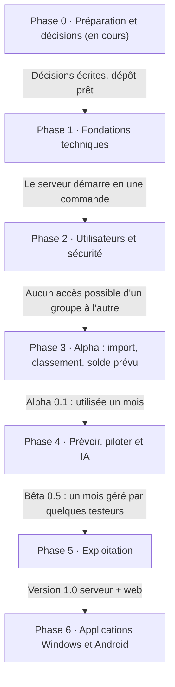

# OwnCoffer — Roadbook serveur et application web

Le serveur et l'application web (installable sur téléphone) passent en premier ; l'alpha est volontairement minimale, puis l'IA arrive en phase 4 — en option : chaque utilisateur décide de la connecter ou non, et l'application est aussi complète sans elle (décision 0006) ; les applications Windows et Android viendront ensuite, sur le même serveur.

- **Six phases jusqu'à la 1.0**, chacune terminée par une validation concrète avant de passer à la suivante.
- **Une version utilisable tôt** : dès la fin de la phase 3, on importe ses vrais relevés Caisse d'Épargne et on voit son solde prévu (version alpha 0.1).
- **Suivi** : chaque phase a son *milestone* GitHub ; les tâches des phases 0 et 1 sont des *issues*. Les cases ci-dessous se cochent au fil de l'avancement.
- **Référence fonctionnelle** : [CAHIER_DES_CHARGES.md](CAHIER_DES_CHARGES.md). **Décisions** : [decisions/](decisions/).

Aucune date n'est fixée : une phase se termine quand sa validation est atteinte.

## Décisions déjà prises

| # | Décision | Statut |
| --- | --- | --- |
| [0001](decisions/0001-framework-serveur-serverpod.md) | Framework du serveur : **Serverpod** | Décidé |
| [0002](decisions/0002-hebergement-serveur-docker-existant.md) | Serveur Docker existant, **accessible depuis l'extérieur** | Décidé, précisé par 0012 |
| [0003](decisions/0003-une-seule-banque-au-depart.md) | **Une seule banque** au départ : **Caisse d'Épargne** | Décidé |
| [0004](decisions/0004-licence-agpl.md) | Licence **AGPL-3.0**, gratuit, financé par les dons | Décidé |
| [0005](decisions/0005-interface-flutter-web.md) | Interface web en **Flutter web** | Décidé |
| [0006](decisions/0006-ia-optionnelle.md) | **IA optionnelle** : l'application est aussi complète sans elle | Décidé |
| [0007](decisions/0007-espace-mon-conseiller.md) | Espace **Mon conseiller** : analyses et recommandations suivies | Décidé |
| [0008](decisions/0008-ia-hybride-passerelle.md) | **IA hybride** (locale ou externe) derrière une **passerelle IA** | Décidé |
| [0009](decisions/0009-actions-proposees-validees.md) | **Modifications proposées**, validées par l'utilisateur, exécutées par le moteur | Décidé |
| [0010](decisions/0010-perimetre-alpha.md) | **Alpha minimale** : import, classement, solde prévu, alerte de découvert | Décidé |
| [0011](decisions/0011-application-web-installable-pwa.md) | Application web **installable sur téléphone** (PWA) | Décidé |
| [0012](decisions/0012-exposition-cloudflare-reseau-hote.md) | Exposition par **Cloudflare**, conteneur sur le **réseau de l'hôte**, **un seul port** | Décidé |
| [0013](decisions/0013-licence-regles-communautaires-cc0.md) | Licence **CC0** pour les règles communautaires | Décidé |
| [0014](decisions/0014-cible-classement-automatique-alpha.md) | Cible de classement automatique de l'alpha : **70 %** | Décidé |
| [0015](decisions/0015-reseau-docker-isole-proxy.md) | **Réseau Docker isolé**, proxy Caddy sur le port unique (remplace la partie réseau de 0012) | Décidé |
| [0016](decisions/0016-rls-apres-alpha.md) | **RLS PostgreSQL repoussée** après l'alpha, test d'isolation obligatoire | Décidé |

## Phase 0 — Préparation et décisions *(en cours)*

Objectif : tout décider et tout organiser avant la première ligne de code.

**Décisions**

- [x] Framework du serveur : Serverpod
- [x] Machine de test : serveur Docker existant, accessible depuis l'extérieur
- [x] Périmètre de départ : une seule banque, la Caisse d'Épargne (décision 0003)
- [x] Contenu de l'alpha (décision 0010) et application installable PWA (décision 0011)
- [x] Licence Serverpod : accepter le risque pour l'usage personnel, trancher avant d'ouvrir à d'autres (décision 0001)
- [x] Interface web : Flutter web (décision 0005)
- [x] Accès extérieur : redirection Cloudflare, réseau de l'hôte, un seul port (décision 0012)
- [x] Licence de la base de règles communautaires : CC0 (décision 0013)
- [x] Cible de classement automatique pour l'alpha : 70 % des opérations classées sans intervention (décision 0014)

**Dépôt GitHub**

- [x] `LICENSE` (AGPL-3.0), `README.md`, `CONTRIBUTING.md` (avec DCO), `SECURITY.md`, `CODE_OF_CONDUCT.md`
- [x] Modèles d'issues (bug, idée) et de pull request
- [x] Dossier `docs/` : cahier des charges, roadbook, décisions
- [x] `CLAUDE.md` : consignes pour le développement avec Claude Code
- [x] Milestones par phase, étiquettes, issues des phases 0 et 1
- [x] Protéger la branche `main` (fusion par pull request ; vérifications au vert à ajouter avec la CI)
- [ ] Tableau de suivi GitHub Projects (optionnel, les milestones suffisent au départ)

**Données et maquettes**

- [ ] Exports anonymisés Caisse d'Épargne (QIF, OFX et CSV si disponibles), sur un à trois mois, noms de fichiers neutres
- [x] Maquettes web : connexion, assistant de premier lancement, opérations, import, catégories et règles, réglages IA, administration ([MAQUETTES.md](MAQUETTES.md))
- [x] Catalogue des catégories standard : 17 catégories, 73 sous-catégories, FR et EN ([CATEGORIES_STANDARD.md](CATEGORIES_STANDARD.md))
- [ ] Avis recueillis grâce à la présentation du projet, cahier des charges ajusté

**Validation** : toutes les décisions prises et écrites, dépôt prêt, relevés de test disponibles.

## Phase 1 — Fondations techniques

Objectif : un serveur vide mais complet, qui se lance en une commande et se teste automatiquement à chaque modification.

- [x] Organisation du code en un seul dépôt : `server/` (Serverpod), `app/` (Flutter, web pour l'instant), `shared/` (modèles et lecture des fichiers bancaires), `docker/`, `docs/`
- [x] `docker/compose.yaml` : réseau Docker privé, **un seul port** configurable publié par un proxy Caddy (app web et API sous `/api/`), PostgreSQL et ports internes jamais publiés ; volume de données ; `.env.example` commenté et générateur de secrets ; démarrage par `docker compose up -d` (décisions 0012 et 0015)
- [x] Base de données v1 avec migrations : utilisateurs, sessions, groupes, membres, comptes, opérations, catégories, catégories standard, règles, imports, journal d'audit
- [x] Montants en centimes (entiers) partout, dates d'opération sans fuseau
- [ ] Intégration continue GitHub Actions : analyse, formatage, tests, image Docker `ghcr.io/cmathias27/owncoffer:edge`
- [ ] Sécurité automatique : Dependabot, CodeQL, vérification des licences des dépendances
- [ ] Page d'état minimale : version, connexion à la base, espace disque
- [x] Bilingue dès le départ : textes de l'interface dans des fichiers de traduction FR et EN
- [x] Application web installable (PWA) : manifeste, icônes, écran d'accueil Android ; aucune donnée financière mise en cache sur l'appareil (décision 0011)

**Validation** : sur le serveur, `docker compose up -d` affiche la page d'accueil web et une page d'état au vert ; la CI est verte sur `main`.

## Phase 2 — Utilisateurs et sécurité

Objectif : se connecter en sécurité, créer des groupes, inviter des membres ; personne ne voit les données d'un autre groupe.

- [x] Assistant de premier lancement : compte administrateur du serveur et premier groupe (côté serveur ; écrans à venir)
- [ ] Connexion email et mot de passe (Argon2), sessions, déconnexion de tous les appareils
- [x] Double authentification TOTP, avec codes de secours (côté serveur ; écrans à venir)
- [x] Blocage automatique des IP (5 échecs en 15 minutes, durée doublée à chaque récidive) et limite de requêtes
- [x] Groupes, rôles (admin, user, lecteur) et invitations par lien expirant (côté serveur ; écrans à venir)
- [x] Permissions côté serveur, testées ; seconde barrière PostgreSQL (RLS) repoussée avant la bêta (décision 0016)
- [x] Journal d'audit des actions sensibles (écriture ; consultation à venir)
- [x] Accès extérieur par Cloudflare (HTTPS géré par Cloudflare) : vraie adresse IP lue dans `CF-Connecting-IP` uniquement si la requête vient de Cloudflare ou du connecteur local, pour que le blocage des IP fonctionne ; option Cloudflare Access en protection supplémentaire (décision 0012)

**Validation** : des tests automatiques prouvent qu'un utilisateur ne peut jamais lire ni modifier les données d'un autre groupe ; une tentative de force brute est bloquée.

## Phase 3 — Alpha : import, classement et solde prévu

Objectif : la plus petite version utile, pour votre usage personnel (décision 0010). Fin de phase = **alpha 0.1**, utilisée un mois avant d'ajouter quoi que ce soit.

**Statut** : toutes les tâches sont faites ; alpha 0.1 publiée le 31 octobre 2026 ([CHANGELOG](../CHANGELOG.md)). Reste la validation ci-dessous.

- [x] Comptes bancaires : création, solde initial, visibilité
- [x] Lecture des exports **Caisse d'Épargne** (format « Money » QIF d'abord, puis OFX et CSV si proposés) dans un module dédié de `shared/`, testée sur des fichiers fictifs reproduisant la structure réelle et sur des fichiers mal formés (accents, virgule décimale, dates françaises)
- [x] Écran d'import : aperçu, compte reconnu (OFX), doublons écartés par empreinte, historique, annulation
- [x] Liste des opérations : recherche, filtres, saisie manuelle, pointage
- [x] Libellés nettoyés (« PRLV SEPA EDF SA REF… » devient « EDF »)
- [x] Classement : catégories reliées au catalogue standard, règles du groupe (écran et testeur), historique, source de la catégorie affichée
- [x] Règles communautaires v0 : 154 règles pour les grandes enseignes (dans `shared/` pour l'alpha ; dépôt séparé `owncoffer-rules` plus tard)
- [x] Opérations prévues récurrentes (loyer, salaire, abonnements) et **solde prévu** à 30 jours, avec son écran (courbe, à venir, rapprochements)
- [x] **Alerte de découvert prévu**, dans l'app (cloche et liste) et par email, vérifiée dès qu'une opération change

**Validation** : trois mois de relevés Caisse d'Épargne importés sans doublon ni erreur de montant ; la cible de classement automatique est atteinte ; l'alpha est utilisée un mois.

## Phase 4 — Prévoir, piloter et IA

Objectif : voir l'avenir de ses comptes, être prévenu à temps, et brancher l'IA en option. Fin de phase = **bêta 0.5**.

**Compléments du cœur**

- [ ] Import groupé, ventilation, corbeille, testeur de règles — *en partie dans la 0.3.0 : ventilation, annulation des actions*
- [ ] Solde de contrôle et détection des frais bancaires — *en partie dans la 0.3.0 : solde de contrôle, frais du mois dans la revue*
- [x] Rapprochement automatique des opérations prévues, reste à vivre, dépenses variables, calendrier des échéances — *reste à vivre et calendrier dans la 0.3.0, dépenses variables estimées dans la 0.3.5*
- [x] Moteur de simulation (sans IA) : simulateur d'achat (solde à une date choisie, point bas, comptant / en plusieurs fois / plus tard) et scénarios comparés côte à côte — *0.3.6*
- [ ] Analyses calculées (sans IA) : évolutions par catégorie, hausses et anomalies chiffrées, objectifs suggérés d'après les 3 à 6 derniers mois, fiabilité des prévisions affichée — *en partie dans la 0.2.0 : classement par catégorie sur la semaine, le mois ou l'année, comparaison à la période précédente et à la moyenne des 3 précédentes, objectif suggéré*
- [ ] Objectifs par catégorie, alertes à 80 %, 100 % et anticipée ; réglages des notifications — *en partie dans la 0.2.0 : objectif mensuel et jauge ; alertes à 80 % et 100 % dans la 0.3.0 ; projection en fin de mois et alerte anticipée dans la 0.3.4 ; restent les réglages des notifications*
- [x] Tableau de bord et graphiques — *en partie dans la 0.2.0 : page Budget (revenus et dépenses sur 6 périodes, classements) et abonnements ; vues lignes, tableau, camembert et graphique, trimestre, 6 à 24 périodes (0.3.16) ; comparaisons entre catégories, périodes et comptes (0.3.18) ; comparaison avec une simulation de changement de contrat (0.3.22) ; accueil (0.3.23)*
- [ ] Crédits avec tableau d'amortissement, paiements en plusieurs fois — *en partie dans la 0.2.0 : crédits à taux fixe, tableau calculé, échéances prévues, remboursement anticipé simulé, taux d'endettement ; crédit déclaré depuis une opération (0.2.1), paiements en plusieurs fois (0.3.0), repérés dans les opérations avec nombre de mensualités réglable (0.3.17) ; restent les événements (renégociation, taux variable) et le crédit renouvelable*
- [x] Page Opérations : **mettre en évidence les abonnements** (repère sur chaque opération rattachée à un abonnement, filtre « Abonnements », lien vers la liste des abonnements) — demandé le 31 octobre 2026
- [ ] Revue de fin de mois et détection d'anomalies — *en partie dans la 0.3.0 : revue du mois*
- [x] **Page d'administration du serveur** (demandée le 31 octobre 2026) : santé, chiffres sans montant, comptes (bloquer), IP bloquées, journal — *0.3.7*, sauvegardes (liste, état de la nuit, sauvegarde à la demande) — *0.3.8*, invitations de tous les groupes — *0.3.9*, mises à jour (automatiques ou non, installation à la demande, notes de version, historique) — *0.3.10*, par un dossier d'échange avec l'hôte
- [x] **Factures** (demandées le 31 octobre 2026) : jointes à une opération (PDF, image, photo recadrée), page Factures avec noms automatiques et export ZIP, factures à rattacher avec propositions, fin de garantie et rappel, envoi par courriel ; en mode serveur comme en mode autonome — jointes à une opération, page Factures, noms automatiques, export ZIP, garantie et rappel, envoi par courriel — *0.3.11* ; factures à rattacher avec propositions — *0.3.14* ; photo recadrée comme par un scanner — *0.3.15*
- [ ] Onglet Feedback

**Conseiller et IA**

- [x] Circuit des modifications proposées (décision 0009) : service de propositions, service de validation, service de commandes financières ; idempotence, refus des propositions périmées, journal d'audit, annulation possible — *0.3.24*
- [ ] Espace **Mon conseiller** (sans IA) : cartes surveiller / anticiper / conseiller / accompagner calculées par le moteur, acceptées, refusées ou ignorées, suivies et justifiées — *en partie dans la 0.3.24 : propositions sur les objectifs, justifiées, acceptées, refusées, annulables ; l'accueil fait la partie « surveiller »*
- [x] Passerelle IA (décision 0008) : interface commune, choix du fournisseur et du modèle par utilisateur, capacités par modèle, aucun basculement automatique vers l'externe, affichage de ce qui quitte le serveur ; clé chiffrée, plafond mensuel — *0.3.25, fournisseurs configurés par l'administrateur (décision 0017)*
- [x] Premiers connecteurs : un externe (compatible API OpenAI) et un local (Ollama) — *0.3.25 : un seul adaptateur, Ollama parlant la même API ; 0.3.29 : Gemini, ChatGPT et Claude prêts à l'emploi, Claude par son API*
- [x] Fonctions de contexte financier en lecture seule (`get_account_overview`, `get_transactions`, `get_budget_status`, `get_upcoming_expenses`, `get_cashflow_forecast`, `get_financial_goals`), limitées aux comptes visibles
- [x] **Serveur MCP** (demandé le 1er novembre 2026) : mêmes fonctions que l'assistant, jeton personnel révocable, comptes visibles, propositions seulement — *0.3.26, décision 0018*
- [x] Catégorisation d'appoint par l'IA, avec la règle suggérée — *catégories proposées dans la 0.3.25 ; règle suggérée, vérifiée et comptée par le moteur, dans la 0.3.28*
- [ ] Lecture de documents : tickets (sans IA : saisie assistée ; avec IA : ventilation ligne par ligne), offres de prêt et confirmations de paiement fractionné (avec IA) ; **tableaux d'amortissement et captures d'écran** des documents du crédit gardés sur le serveur (0.3.1) : l'IA propose les conditions du crédit (mensualité, taux, durée, capital restant) et l'utilisateur valide — demandé le 31 octobre 2026
- [ ] Assistant IA (en option) : interroge le moteur, explique, pose les scénarios en langage naturel ; mémoire des préférences, historique des conseils, sources affichées, analyse contestable
- [ ] Licence Serverpod clarifiée avant d'ouvrir la bêta à d'autres personnes (décision 0001)
- [ ] Row Level Security PostgreSQL réévaluée avant d'ouvrir la bêta (décision 0016)

**Validation** : un mois complet géré dans OwnCoffer par deux ou trois testeurs, dont au moins un **sans IA** ; les prévisions à 30 jours restent proches du solde réel.

## Phase 5 — Exploitation et version 1.0

Objectif : un serveur qu'on installe, sauvegarde et met à jour sans y penser. Fin de phase = **1.0 serveur + web**.

- [ ] Sauvegardes chiffrées chaque nuit et avant chaque mise à jour, restauration testée automatiquement
- [ ] Service de mise à jour (Stable et Bêta), notification à l'admin, retour arrière en cas d'échec
- [ ] Console d'administration : utilisateurs, sessions, IP bloquées, retours, état du serveur
- [ ] Mode démo et export complet des données (JSON, CSV)
- [ ] Traductions FR et EN complètes, accessibilité, rapidité avec 100 000 opérations
- [ ] Documentation : installation, utilisation, FAQ
- [ ] Publication signée, notes de version, liste des composants (SBOM)
- [ ] Audit de sécurité externe si possible

**Validation** : une personne extérieure installe OwnCoffer seule en moins de 30 minutes ; une mise à jour et une restauration réussissent sans intervention.

## Ensuite

**Phase 6 — Applications Windows et Android natives** (Android est déjà couvert entre-temps par l'application web installable) : même code Flutter connecté au serveur, hors-ligne et synchronisation, page « Télécharger », mises à jour automatiques, puis version autonome sans serveur.

Les autres fonctionnalités du cahier des charges marquées « Après 1.0 » s'ajouteront une par une, selon les avis des utilisateurs.
