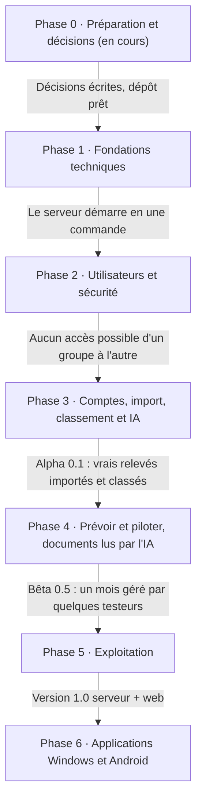

# OwnCoffer — Roadbook serveur et application web

Le serveur et l'application web passent en premier, avec l'IA intégrée dès la phase 3 ; les applications Windows et Android viendront ensuite, sur le même serveur.

- **Six phases jusqu'à la 1.0**, chacune terminée par une validation concrète avant de passer à la suivante.
- **Une version utilisable tôt** : dès la fin de la phase 3, on importe ses vrais relevés (version alpha 0.1).
- **Suivi** : chaque phase a son *milestone* GitHub ; les tâches des phases 0 et 1 sont des *issues*. Les cases ci-dessous se cochent au fil de l'avancement.
- **Référence fonctionnelle** : [CAHIER_DES_CHARGES.md](CAHIER_DES_CHARGES.md). **Décisions** : [decisions/](decisions/).

Aucune date n'est fixée : une phase se termine quand sa validation est atteinte.

## Décisions déjà prises

| # | Décision | Statut |
| --- | --- | --- |
| [0001](decisions/0001-framework-serveur-serverpod.md) | Framework du serveur : **Serverpod** | Décidé |
| [0002](decisions/0002-hebergement-serveur-docker-existant.md) | Serveur Docker existant, **accessible depuis l'extérieur** | Décidé |
| [0003](decisions/0003-une-seule-banque-au-depart.md) | **Une seule banque** prise en charge au départ | Décidé |
| [0004](decisions/0004-licence-agpl.md) | Licence **AGPL-3.0**, gratuit, financé par les dons | Décidé |
| [0005](decisions/0005-interface-flutter-web.md) | Interface web en **Flutter web** | Proposé |

## Phase 0 — Préparation et décisions *(en cours)*

Objectif : tout décider et tout organiser avant la première ligne de code.

**Décisions**

- [x] Framework du serveur : Serverpod
- [x] Machine de test : serveur Docker existant, accessible depuis l'extérieur
- [x] Périmètre de départ : une seule banque
- [ ] Interface web : confirmer Flutter web (décision 0005)
- [ ] Nom de domaine et certificat HTTPS pour l'accès extérieur
- [ ] Licence de la base de règles communautaires (CC0 ou ODbL)
- [ ] Cible de classement automatique pour l'alpha (proposition : 70 % des opérations classées sans intervention)

**Dépôt GitHub**

- [x] `LICENSE` (AGPL-3.0), `README.md`, `CONTRIBUTING.md` (avec DCO), `SECURITY.md`, `CODE_OF_CONDUCT.md`
- [x] Modèles d'issues (bug, idée) et de pull request
- [x] Dossier `docs/` : cahier des charges, roadbook, décisions
- [x] `CLAUDE.md` : consignes pour le développement avec Claude Code
- [x] Milestones par phase, étiquettes, issues des phases 0 et 1
- [ ] Protéger la branche `main` (réglages GitHub : fusion par pull request, vérifications au vert)
- [ ] Tableau de suivi GitHub Projects (optionnel, les milestones suffisent au départ)

**Données et maquettes**

- [ ] Exports anonymisés de la banque choisie (QIF, OFX et CSV si disponibles), sur un à trois mois, noms de fichiers neutres
- [ ] Maquettes web manquantes : connexion, assistant de premier lancement, liste des opérations, import, catégories et règles, réglages, administration
- [ ] Liste des catégories standard (environ 15 catégories et 60 sous-catégories, en français et en anglais)
- [ ] Avis recueillis grâce à la présentation du projet, cahier des charges ajusté

**Validation** : toutes les décisions prises et écrites, dépôt prêt, relevés de test disponibles.

## Phase 1 — Fondations techniques

Objectif : un serveur vide mais complet, qui se lance en une commande et se teste automatiquement à chaque modification.

- [ ] Organisation du code en un seul dépôt : `server/` (Serverpod), `app/` (Flutter, web pour l'instant), `shared/` (modèles et lecture des fichiers bancaires), `docker/`, `docs/`
- [ ] `docker-compose.yml` : serveur + PostgreSQL + volume de données, `.env.example` commenté, démarrage par `docker compose up -d`
- [ ] Base de données v1 avec migrations : utilisateurs, sessions, groupes, membres, comptes, opérations, catégories, catégories standard, règles, imports, journal d'audit
- [ ] Montants en centimes (entiers) partout, dates d'opération sans fuseau
- [ ] Intégration continue GitHub Actions : analyse, formatage, tests, image Docker `ghcr.io/cmathias27/owncoffer:edge`
- [ ] Sécurité automatique : Dependabot, CodeQL, vérification des licences des dépendances
- [ ] Page d'état minimale : version, connexion à la base, espace disque
- [ ] Bilingue dès le départ : textes de l'interface dans des fichiers de traduction FR et EN

**Validation** : sur le serveur, `docker compose up -d` affiche la page d'accueil web et une page d'état au vert ; la CI est verte sur `main`.

## Phase 2 — Utilisateurs et sécurité

Objectif : se connecter en sécurité, créer des groupes, inviter des membres ; personne ne voit les données d'un autre groupe.

- [ ] Assistant de premier lancement : compte administrateur du serveur et premier groupe
- [ ] Connexion email et mot de passe (Argon2), sessions, déconnexion de tous les appareils
- [ ] Double authentification TOTP, avec codes de secours
- [ ] Blocage automatique des IP (5 échecs en 15 minutes, durée doublée à chaque récidive) et limite de requêtes
- [ ] Groupes, rôles (admin, user, lecteur) et invitations par lien expirant
- [ ] Permissions à deux niveaux : serveur puis PostgreSQL (RLS)
- [ ] Journal d'audit des actions sensibles
- [ ] HTTPS : guide d'installation avec reverse proxy (Caddy) et Let's Encrypt, adapté au serveur existant

**Validation** : des tests automatiques prouvent qu'un utilisateur ne peut jamais lire ni modifier les données d'un autre groupe ; une tentative de force brute est bloquée.

## Phase 3 — Comptes, import, classement et IA

Objectif : importer ses vrais relevés et voir ses opérations classées, avec l'IA en appoint. Fin de phase = **alpha 0.1**.

- [ ] Comptes bancaires : création, solde initial, visibilité
- [ ] Lecture des fichiers de la banque choisie (QIF, puis OFX et CSV) dans `shared/`, testée sur les relevés anonymisés et sur des fichiers mal formés
- [ ] Écran d'import : aperçu, compte reconnu, doublons écartés par empreinte, historique, annulation, import groupé
- [ ] Liste des opérations : recherche, filtres, saisie manuelle, pointage, ventilation, corbeille
- [ ] Libellés nettoyés (« PRLV SEPA EDF SA REF… » devient « EDF »)
- [ ] Classement : catégories reliées au catalogue standard, règles du groupe, historique, testeur de règles, source de la catégorie affichée
- [ ] Règles communautaires v0 : dépôt séparé `owncoffer-rules`, premières règles pour les grandes enseignes françaises
- [ ] Solde de contrôle et détection des frais bancaires
- [ ] Connexions IA par utilisateur : fournisseur au choix (Claude, OpenAI, Mistral, Gemini, modèle local), clé chiffrée, plafond mensuel, appels relayés par le serveur
- [ ] Catégorisation d'appoint par l'IA pour les opérations restées non classées, avec la règle suggérée
- [ ] Lecture de tickets de caisse par l'IA : photo → opération ventilée ligne par ligne, validée par l'utilisateur

**Validation** : trois mois de relevés réels importés sans doublon ni erreur de montant ; la cible de classement automatique est atteinte.

## Phase 4 — Prévoir et piloter, documents lus par l'IA

Objectif : voir l'avenir de ses comptes et être prévenu à temps. Fin de phase = **bêta 0.5**.

- [ ] Opérations prévues ponctuelles et récurrentes, rapprochement automatique
- [ ] Moteur de prévision : solde futur, reste à vivre, dépenses variables, calendrier des échéances
- [ ] Simulateur d'achat : solde à une date choisie, point bas, comptant / en plusieurs fois / plus tard
- [ ] Objectifs par catégorie, alertes à 80 %, 100 % et anticipée
- [ ] Notifications dans l'app web et par email
- [ ] Tableau de bord et graphiques
- [ ] Crédits avec tableau d'amortissement, paiements en plusieurs fois
- [ ] Lecture par l'IA des offres de prêt (→ crédit et tableau d'amortissement, recalculé pour contrôle) et des confirmations de paiement fractionné (→ échéancier)
- [ ] Bilan du mois en langage clair et questions sur ses dépenses (IA, en option)
- [ ] Revue de fin de mois et détection d'anomalies
- [ ] Onglet Feedback

**Validation** : un mois complet géré dans OwnCoffer par deux ou trois testeurs ; les prévisions à 30 jours restent proches du solde réel.

## Phase 5 — Exploitation et version 1.0

Objectif : un serveur qu'on installe, sauvegarde et met à jour sans y penser. Fin de phase = **1.0 serveur + web**.

- [ ] Sauvegardes chaque nuit et avant chaque mise à jour, restauration testée automatiquement
- [ ] Service de mise à jour (Stable et Bêta), notification à l'admin, retour arrière en cas d'échec
- [ ] Console d'administration : utilisateurs, sessions, IP bloquées, retours, état du serveur
- [ ] Mode démo et export complet des données (JSON, CSV)
- [ ] Traductions FR et EN complètes, accessibilité, rapidité avec 100 000 opérations
- [ ] Documentation : installation, utilisation, FAQ
- [ ] Publication signée, notes de version, liste des composants (SBOM)
- [ ] Audit de sécurité externe si possible

**Validation** : une personne extérieure installe OwnCoffer seule en moins de 30 minutes ; une mise à jour et une restauration réussissent sans intervention.

## Ensuite

**Phase 6 — Applications Windows et Android** : même code Flutter connecté au serveur, hors-ligne et synchronisation, page « Télécharger », mises à jour automatiques, puis version autonome sans serveur.

Les autres fonctionnalités du cahier des charges marquées « Après 1.0 » s'ajouteront une par une, selon les avis des utilisateurs.
